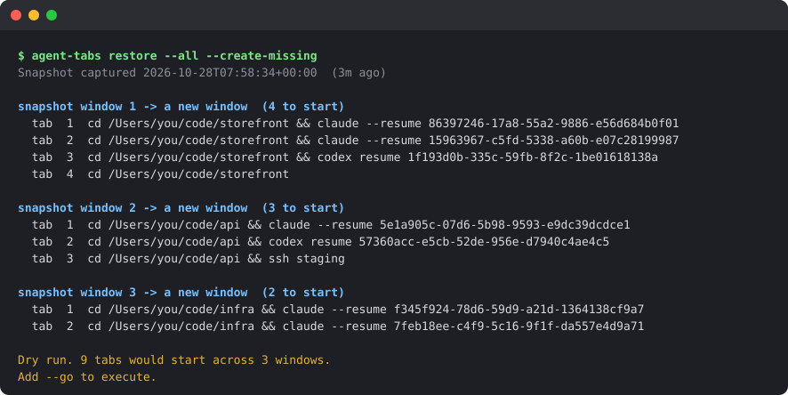

# agent-tabs

[](https://github.com/levadadenys/agent-tabs/actions/workflows/ci.yml)
[](https://github.com/levadadenys/agent-tabs/actions/workflows/tests.yml)


[](LICENSE)

**Get every terminal window full of AI coding agents back after a crash or
reboot.** agent-tabs records which Claude Code, Codex or Grok session runs in
which iTerm2 window and tab, and in which directory. After a crash it rebuilds
those windows and resumes each session where it was.

It does not save or read your conversations; the agents keep those on disk
themselves. For each tab it records the directory, the tab title, the command
running there and the agent's session id, in `~/.agent-tabs`, readable only by
you. It makes no network connections, needs nothing beyond the Python that
ships with macOS, and types nothing until you pass `--go`. macOS and iTerm2
only.

**Quick start:** [install](#install) it once. After a crash or reboot, open a
new iTerm window and run `agent-tabs restore --all --create-missing` to see the
plan, then again with `--go` to carry it out.

<p align="center"></p>
<p align="center"><sub>A dry run after a reboot, with made-up projects: the plan is printed by the real
code, with iTerm's live state stubbed (<a href="docs/demo/make_demo.py">docs/demo/make_demo.py</a>).
Nothing is typed until <code>--go</code>.</sub></p>

## Why

Claude, Codex and Grok keep their transcripts on disk, so a crash never loses a
conversation. What it loses is the **grouping**: which session was in which
iTerm window and tab, and in what working directory. With a dozen sessions
across several windows, nothing records that, so recovery means guessing from
file timestamps and resuming sessions one by one.

`agent-tabs` records the grouping every 30 seconds (configurable) while you work,
and replays it afterwards.

## What you need

- **macOS and iTerm2.** Developed and tested on macOS 26 with iTerm2 3.6.
- **Python 3.9 or later.** The `python3` that comes with macOS (Xcode Command
  Line Tools) is enough; there are no dependencies to install.
- **At least one agent CLI**: [Claude Code](https://claude.com/claude-code),
  Codex or Grok. Other tabs are restored too: an `ssh` session or a dev server is
  replayed, a plain shell gets its directory back.

macOS may ask whether the recorder may control iTerm (System Settings →
Privacy & Security → Automation). Allow it: that is how the window and tab
layout is read.

## Install

```bash
git clone https://github.com/levadadenys/agent-tabs.git
cd agent-tabs && ./bin/agent-tabs install
```

That:

- installs the recorder as a **launchd agent**, capturing every 30 seconds by
  default (see [Config](#config));
- links `agent-tabs` into `~/.local/bin`;
- links a `resume-tabs` skill into `~/.claude/skills`, so you can ask Claude to
  restore your tabs.

No iTerm restart is needed, and recording continues across iTerm restarts.
Check it with `agent-tabs list`: the snapshot should be seconds old.

If your shell says `agent-tabs: command not found`, `~/.local/bin` is not on
your `PATH` (it is not, on a fresh macOS). Add it, then open a new tab:

```bash
echo 'export PATH="$HOME/.local/bin:$PATH"' >> ~/.zshrc
```

`install` exits non-zero if the recorder fails to load, so a script can rely on
its exit code.

### Stop or uninstall

```bash
launchctl list | grep agent-tabs                    # is the recorder registered?
launchctl bootout gui/$UID/com.agent-tabs.recorder   # stop it until next login
```

`bootout` only lasts until the next login: the job is loaded again from
`~/Library/LaunchAgents`. To remove it for good:

```bash
launchctl bootout gui/$UID/com.agent-tabs.recorder
rm ~/Library/LaunchAgents/com.agent-tabs.recorder.plist
rm ~/.local/bin/agent-tabs ~/.claude/skills/resume-tabs
rm -rf ~/.agent-tabs                                  # snapshots and history
```

## After a crash or reboot

Open a **new** iTerm window (⌘N) and check what was recorded:

```bash
agent-tabs list
```

The first line shows when the snapshot was taken. It should be from just before
the crash or reboot. If it says hours or days, the recorder was not running —
see [Troubleshooting](#troubleshooting) before restoring.

Then, from a new window, one command restores everything:

```bash
agent-tabs restore --all --create-missing        # dry run: the plan for every window
agent-tabs restore --all --create-missing --go   # carry it out
```

- **Windows iTerm reopened** (with *Reopen windows when logging back in* ticked)
  are recognized by each tab's working directory, which iTerm keeps, and their
  sessions are restored in place. Their titles are reset to the shell's name,
  so the directories are what identifies them.
- **Windows that survived** a crash (agents killed, iTerm still open) are
  recognized by their tab titles as well.
- **Windows nothing matches**, or iTerm did not reopen, are rebuilt in a new
  window. That includes one an idle reopened window *might* be, where the
  evidence fits more than one: it is rebuilt beside it, and the idle one can be
  closed. One that a window with something running might be is reported
  instead, since rebuilding could run an ssh tab twice.

Run it from a new window: the window you run it from is never paired, because
one of its tabs is the one you are typing in. If `list` says the snapshot was
captured after the reboot, add the `-f ~/.agent-tabs/pre-boot.json` it prints,
so the restore uses the sessions from before the reboot. Without
`--create-missing`, nothing new is created: unmatched windows are only listed,
with the command that rebuilds each.

**Restore before starting new sessions.** Everything is a dry run until you add
`--go`, and a session that is already running anywhere is never started twice,
so it is safe to run the dry run first and read it.

## Commands

```bash
agent-tabs snapshot                       # capture now (the recorder does this every 30s by default)
agent-tabs list                           # what the snapshot holds, with restore commands
agent-tabs list --kind codex              # only one kind of tab (filters on kind, not title)
agent-tabs list --commands                # bare restore commands, one per line
agent-tabs list -f <file>                 # read a specific snapshot, e.g. from history

agent-tabs restore --all                  # every window at once (dry run)
agent-tabs restore --all --create-missing # ...and rebuild windows iTerm did not restore
agent-tabs restore                        # just the window you are in (dry run)
agent-tabs restore 2                      # snapshot window 2 into the window you are in
agent-tabs restore 2 --new-window         # snapshot window 2 into a new window
agent-tabs restore ... --go               # actually do it
agent-tabs restore ... -f <file>          # restore from a specific snapshot file
```

`restore` without `--all` or `--new-window` fills the iTerm window it is run
from, so run it from inside that window. Run `--all` from a new window (⌘N): the
window it runs in is never paired.

## What gets restored

A snapshot joins three sources:

| Source | Gives |
|---|---|
| iTerm2 AppleScript | window → tab → tty, plus the tab title |
| `ps` | tty → the process running in that tab |
| per-agent lookup | that process → session id + working directory |

| Agent | Identified by | Restored with |
|---|---|---|
| Claude | `~/.claude/sessions/<pid>.json` | `claude --resume <uuid>` |
| Codex | the rollout transcript it holds open (`lsof`) | `codex resume <uuid>` |
| Grok | open files under `~/.grok/sessions/<urlencoded-cwd>/<uuid>/` | `grok --resume <uuid>` |
| ssh / other | the command line | replayed, unless it contains shell syntax |
| plain shell | working directory only | `cd <cwd>` |

Every restore command is `cd <cwd> && <resume>`, never the resume alone: all
three agents scope their session pickers to the working directory, so a resume
run from the wrong directory reports the session as missing.

## Safety

Restore types into live shells, so it is conservative by default:

- **Dry run** unless you pass `--go`.
- **Never types into a tab doing something** — an agent, but equally `vim`,
  `psql` or an `ssh` session, where typed text would run on the remote host.
  Override with `--force`, which is refused unless restore runs in an iTerm
  tab (not a script, tmux or ssh): otherwise it could not tell which tab is its
  own. It also never types into the tab it runs from.
  Liveness is checked again immediately before typing, not only when planning.
- **Never starts a session that is already running** anywhere, in any window
  — nor twice in one restore, if the snapshot lists it in two tabs. This is
  checked when planning and again immediately before typing, so a session you
  resume by hand in the meantime is skipped. Only one `restore --go` runs at a
  time; a second one stops and tells you. `--force` does not override any of
  this: it is about busy tabs, and a duplicate session is never wanted.
- **Never replays shell syntax.** A recorded command line containing it is
  reported and downgraded to a bare `cd`, because argv is data any local process
  controls and restore can run unattended.
- **Never creates windows unless asked**, with `--create-missing` or
  `--new-window`.

### How `--all` pairs windows

A wrong pairing would type one window's sessions into another, so each live
window is paired with the snapshot window it resembles most, one to one, and
only when the evidence leaves no other choice. The evidence is the tab titles
they share, plus the tabs, position by position, that sit in the same directory:
at least two of them, or every tab of two windows the same size. Ties are
reported, never guessed; a title that is only a shell name (`-zsh`) and the home
directory do not count; the window you run it from is never paired. Anything not
paired is listed with the command that restores it. The full rules are in
[docs/HOW_IT_WORKS.md](docs/HOW_IT_WORKS.md#pairing-live-windows-with-snapshot-windows-restore---all).

## Snapshots and reboots

A **snapshot** is the record of every window, tab and session at one moment.
The recorder takes one per capture; the newest one worth trusting is kept as
`snapshot.json`, and that is what `list` and `restore` use.

- `~/.agent-tabs/snapshot.json` — the snapshot `list` and `restore` use
- `~/.agent-tabs/history/` — every capture from the last half hour, never fewer
  than the newest 60 (so a long sleep does not empty it), at most 180
- `~/.agent-tabs/pre-boot.json` — the fullest snapshot from before the most
  recent reboot
- `~/.agent-tabs/recorder.log` — recorder errors

A capture does not always replace `snapshot.json`, because the moment it
matters most is a shutdown, when tabs close one by one. A capture with no agent
sessions never does. One that lost a third or more of the sessions waits until
the drop has lasted three captures and 45 seconds (about a minute at the
default interval); a shutdown is over long before that. Closing a tab or two is
taken at once.

After a reboot, the first snapshot taken also saves the pre-reboot sessions in
`pre-boot.json`. If a small post-reboot capture has replaced `snapshot.json`
before you restored, `list` and `restore` say so and print the command to use
instead:

```bash
agent-tabs restore --all --create-missing -f ~/.agent-tabs/pre-boot.json
```

Any capture in `history/` can be restored the same way with `-f`. The rules,
and why each exists, are in
[docs/HOW_IT_WORKS.md](docs/HOW_IT_WORKS.md#which-capture-becomes-the-snapshot).

## Troubleshooting

**The snapshot is hours or days old.** The recorder is not running. Check
`launchctl list | grep agent-tabs` and `tail ~/.agent-tabs/recorder.log`, then run
`agent-tabs install` again from the repository. If the log shows AppleScript
errors, check that your terminal is allowed to control iTerm under System
Settings → Privacy & Security → Automation.

**"Could not auto-match this window."** Plain `restore` could not tell which
snapshot window this is. Run `agent-tabs list` and pass the number, or use
`--all`.

**"Not running inside an iTerm tab."** Plain `restore` fills the window it runs
in. Run it from an iTerm tab, or use `--all` or `--new-window`.

**"The one you are in looks like snapshot window N" / "was not paired."** `--all` never
fills the window it runs from. Open a new window (⌘N) and run it again; what is already running is
skipped. With `--create-missing`, that window is rebuilt in a new window
instead.

**A window was not restored.** `restore --all` lists why under *Not restored*,
with the command for each: ambiguous, too many windows sharing titles, no live
window matched, a live window might be it, or it is the window you ran it
from. `--create-missing` rebuilds the unmatched ones, but not one that an
unpaired live window might be.

**"Cannot take the restore lock."** `~/.agent-tabs` (or `AGENT_TABS_HOME`) is not
writable. Nothing was typed; fix the permissions and run it again.

**A restored tab says "No conversation found with session ID".** When Claude
Code starts, it deletes conversations not modified for `cleanupPeriodDays` (30
by default). A tab left idle that long can lose its conversation while it sits
open, and then nothing can resume it. To keep long-lived tabs resumable, set
`"cleanupPeriodDays": 365` in `~/.claude/settings.json`.

**A tab says "session already running in …".** It is: restoring it would start a
duplicate. Nothing to do. "Same session as tab N of snapshot window W, started
once" means the snapshot listed that session twice; it is restored once.

## Config

Optional, in `~/.agent-tabs/config.json`, outside the repository; see
`config.example.json`. `codex_profiles` maps an absolute `CODEX_HOME` to the
command that selects that Codex account, for people running more than one:

```json
{"codex_profiles": {"/Users/you/.codex-work": "codex work"}}
```

Without an entry, Codex is resumed with plain `codex`.

`interval_seconds` sets how often the recorder captures, from 10 to 300
(default 30). A shorter interval loses fewer sessions in a crash and costs more
CPU: one capture takes about 2 s with two dozen sessions. Run `agent-tabs
install` again to apply a change; it says which interval the recorder now runs
at, and corrects a value out of range or not a whole number:

```json
{"interval_seconds": 60}
```

History is kept by age, not count: the last half hour at any interval, and
never fewer than 60 captures, so at a long interval it reaches further back (at
300 s, about 5 hours). `AGENT_TABS_HOME` relocates `~/.agent-tabs`, mainly for testing.

## Limits

- macOS and iTerm2 only.
- Split panes are recorded, but only the first pane of each tab is recreated.
- It only helps for crashes **after** it is installed. For an earlier one, see
  the manual notes in `skills/resume-tabs/SKILL.md`.
- A deleted git worktree must be recreated at its old path before a session that
  ran inside it can be resumed.
- Pairing is by tab titles and tab directories. Shell-name titles and the home
  directory are ignored, and one matching directory counts only for a window
  of one tab. But any other shared title, or two tabs in the same project
  directories at the same positions, counts. So an unrelated window that
  happens to match can still pair when nothing else competes. The dry run shows
  every pairing before anything is typed.
- Only agent sessions with an id are deduplicated. An ssh tab or another
  recorded command has no session to check, so restoring the same snapshot
  twice into new windows — two `--create-missing` runs whose first windows no
  longer match — runs it twice. Read the dry run.
- A capture that lost most of its sessions is held back by comparing it with
  the last good snapshot. If `snapshot.json` is unreadable and history holds no
  capture with sessions, there is nothing to compare with, and a small capture
  can replace it; `pre-boot.json` still holds the pre-reboot sessions.
- Tab positions are read when planning. Reordering tabs *within* a window
  between the dry run and `--go` could put a command in the wrong tab of the
  right window.

## What has been exercised for real

- A genuine crash has been restored from, window by window.
- **Two real reboots** in October 2026, on macOS 26.3 with iTerm2 3.6.9.
- **The first** (30 agent sessions in 5 windows) exposed two problems:
  - reading iTerm's window list by position raced with the windows a restore
    creates and focuses, so every attempt stopped part-way;
  - windows iTerm reopened came back titled `-zsh`, so they could not be
    paired and were rebuilt beside the blanks.

  The list is now read by window id, and reopened windows are recognized by
  their tabs' working directories. Once the race was fixed, a single restore from
  `pre-boot.json` resumed 28 of the 30 sessions. The other 2 could not be:
  Claude Code had deleted their transcripts after 30 idle days (see
  [Troubleshooting](#troubleshooting)).
- **The second** had *Reopen windows when logging back in* ticked, with 28
  agent sessions in 6 windows. It was restored from a new window by asking
  Claude, through the `resume-tabs` skill. **All 28 sessions resumed, in the
  windows iTerm reopened**: each live window matched one pre-reboot window, and
  none was rebuilt beside it.
- The recorder has run unattended under launchd since September 2026.

Run the dry run first and read it.

## FAQ

**Does it read my conversations?** No. For Claude it reads the small pointer
file Claude writes for each running process (`~/.claude/sessions/<pid>.json`:
the session id and directory). For Codex and Grok it looks only at the *paths*
of files the process has open, which contain the session id. No transcript is
opened.

**Does it send anything anywhere?** No. It makes no network connections. The
snapshots stay in `~/.agent-tabs`, readable only by you.

**Will it start a session twice?** No. A session that is already running in any
iTerm tab is skipped, checked when planning and again just before typing, and
`--force` does not change that. See [Safety](#safety).

**What does it cost while I work?** One capture takes about 2 seconds with two
dozen sessions, mostly AppleScript, `ps` and `lsof`: roughly 6% of one core at
the default 30-second interval, in bursts. Raise `interval_seconds` to spend
less.

**Why only iTerm2?** Recording needs a terminal that can list its windows and
tabs with their ttys and type into a given tab, from a plain shell and from
launchd. iTerm2's AppleScript does that without its optional Python runtime.
Other terminals are on the [roadmap](#roadmap).

**Does it handle split panes?** Every pane is recorded, but only the first pane
of each tab is recreated.

**I uninstalled it. Is anything left behind?** See [Stop or
uninstall](#stop-or-uninstall): the launchd job, two symlinks and
`~/.agent-tabs`.

## Roadmap

- **More terminals:** Terminal.app, Ghostty, WezTerm, kitty, and tmux, which
  would also bring Linux. The design and the recommended order are in
  [docs/specs/MULTI_TERMINAL.md](docs/specs/MULTI_TERMINAL.md); nothing is built
  yet.
- **Split panes** recreated, not only recorded.

## Development

```bash
python3 tests/run_all.py
```

Lint and type checks run as in CI; [CONTRIBUTING.md](CONTRIBUTING.md#getting-started)
has the setup (a virtualenv on Python 3.10+, since the pinned mypy no longer
supports 3.9; agent-tabs itself needs none of these tools):

```bash
ruff check . && ruff format --check . && mypy && shellcheck .githooks/pre-push
```

No test framework and no dependencies. The tests drive real call sites where
the mechanism is the point — the Codex account test spawns a real process
holding a real rollout file and resolves it through a real `lsof`, and the
snapshot tests exercise actual filesystem state. The window matcher is also
checked against an independent brute-force oracle on hundreds of random
instances. Each test was mutation-checked: reverting the fix it covers makes it
fail.

## Contributing

Bug reports and pull requests are welcome; see [CONTRIBUTING.md](CONTRIBUTING.md)
for setup, the testing rules and the safety rules a change must not break.
Report security problems privately, as described in [SECURITY.md](SECURITY.md).
Changes are listed in [CHANGELOG.md](CHANGELOG.md).

## License

[MIT](LICENSE)
